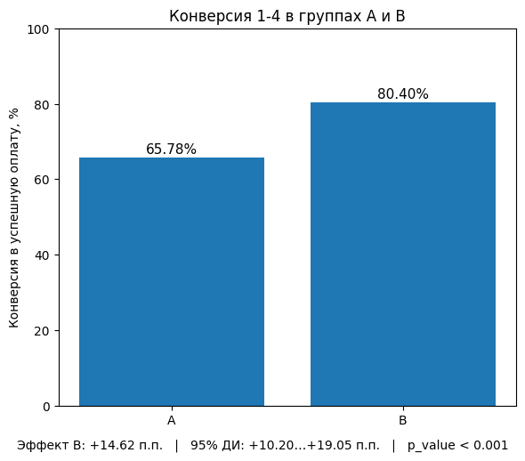
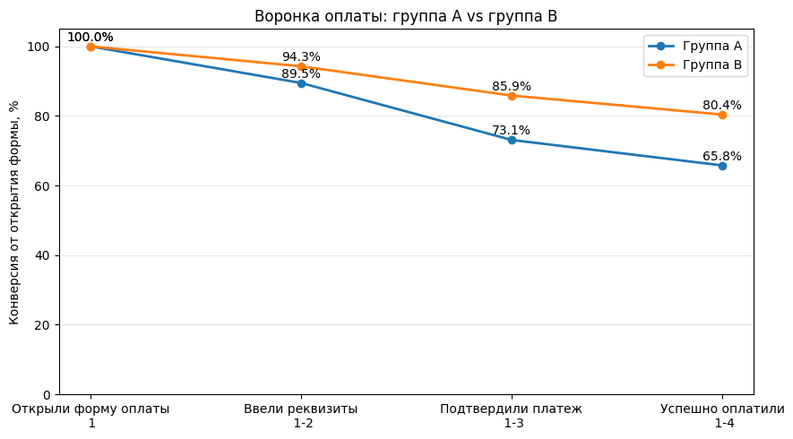

# A/B-тест новой формы оплаты ЖКХ

**Product Analytics · A/B Testing · Python · Pandas · SciPy · Statsmodels**

[](https://colab.research.google.com/github/AnastasiaAt/A-B-test-payment-conversion/blob/main/ab_test_payment_conversion.ipynb)

> **Задача:** проверить, увеличивает ли упрощённое автозаполнение реквизитов долю успешных оплат ЖКХ, и подготовить рекомендацию по внедрению новой формы.
>
> Учебный аналитический кейс. Период эксперимента: **1-30 апреля 2024 года**.

## Главный результат

| Основная метрика | Контрольная группа A | Тестовая группа B |
|:--|--:|--:|
| Пользователей, открывших форму | 751 | 750 |
| Успешно оплатили | 494 | 603 |
| **Конверсия 1-4** | **65,78%** | **80,40%** |

**Абсолютный рост конверсии:** **+14,62 п. п.** (+22,2% относительный рост).  
**Статистическая проверка:** двусторонний z-тест двух пропорций, **p_value < 0,001**.  
**95%-й доверительный интервал разницы:** **[+10,20; +19,05] п. п.**



## Продуктовая задача и метрика

Эксперимент сравнивает две формы оплаты ЖКХ. 

Изменение: добавили упрощенное автозаполнение реквизитов.

Гипотеза: упрощённое автозаполнение реквизитов увеличивает долю успешных оплат ЖКХ.

Воронка состоит из четырёх событий:

1. Открытие формы оплаты.
2. Ввод реквизитов.
3. Подтверждение платежа.
4. Успешная оплата.

**Единица анализа - уникальный пользователь, не отдельная попытка.** Пользователь учитывается на этапе, если достиг его хотя бы в одной попытке. Основная метрика - доля пользователей, открывших форму, которые хотя бы раз успешно оплатили.

## Воронка пользователей



| Этап (от открытия формы) | A | B |
|:--|--:|--:|
| Открыли форму | 100% | 100% |
| Ввели реквизиты | 89,48% | 94,27% |
| Подтвердили платёж | 73,10% | 85,87% |
| Успешно оплатили | 65,78% | 80,40% |

График показывает **конверсию относительно первого шага**. В ноутбуке дополнительно рассчитаны конверсии соседних переходов 1-2, 2-3 и 3-4.

## Проведённый анализ

- **EDA и очистка:** пропуски, дубликаты, аномальный возраст, проверка и исправление расхождений в группах А/В между таблицами Users и Payments.
- **Проверка событий:** период теста, целостность воронки и хронологический порядок событий.
- **Проверка эксперимента:** SRM для ожидаемого сплита 50/50, сравнение распределений устройств, городов и возраста.
- **Повторные попытки:** число попыток на пользователя и пользовательская воронка.
- **Оценка эффекта:** конверсии, двусторонний z-тест двух пропорций, 95%-й доверительный интервал.
- **Дополнительный срез:** сравнение конверсий на Android и iOS.

### Подготовка данных

| Показатель | До очистки | После очистки |
|:--|--:|--:|
| Пользователи (`Users`) | 1 504 | 1 503 |
| Записи платёжных попыток (`Payments`) | 2 661 | 2 660 |

Исключены пользователь без назначения A/B и запись попытки без `user_id`. Несоответствие группы пользователя `1010` исправлено по таблице `Users`; аномальные значения возраста -5 и 150 лет заменены пропусками. Два пользователя отсутствуют в `Payments`, поэтому в основной воронке **1 501 пользователь**.

Проверка SRM не выявила существенного отклонения от ожидаемого сплита 50/50 (**p_value ≈ 0,979**). При сравнении устройств результат пограничный: **p_value = 0,053** с поправкой Йейтса и **p_value = 0,047** без неё. Эти проверки не доказывают корректность самого механизма рандомизации.

## Дополнительный анализ по платформам

| Платформа | Конверсия A | Конверсия B | Разница |
|:--|--:|--:|--:|
| Android | 64,62% | 79,95% | +15,33 п. п. |
| iOS | 67,15% | 80,84% | +13,69 п. п. |

Положительное различие наблюдается на обеих платформах; отдельный тест равенства эффектов между платформами не проводился.

## Вывод и рекомендация

Вариант B показал статистически значимое повышение основной конверсии. Однако медианное количество попыток оплаты в группе B равно **2**, тогда как в группе A - **1**; причина различия требует дополнительного изучения.

В исходном наборе данных отсутствуют сведения о возвратах, технических ошибках и времени обработки платежей. **Рекомендация:** проверить дополнительные продуктовые и технические показатели; при отсутствии ухудшения - внедрять вариант B с последующим мониторингом конверсии и качества платежей.


## Структура репозитория

```text
.
├── README.md                 # описание, результаты, графики
├── ab_test_payment_conversion.ipynb            # полный анализ в Jupyter/Colab
└── images/
    ├── overall_conversion.png
    └── payment_funnel.png
```
